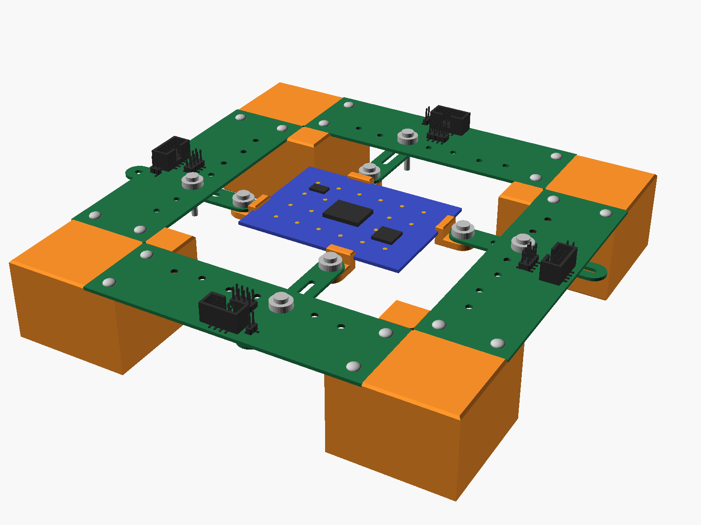
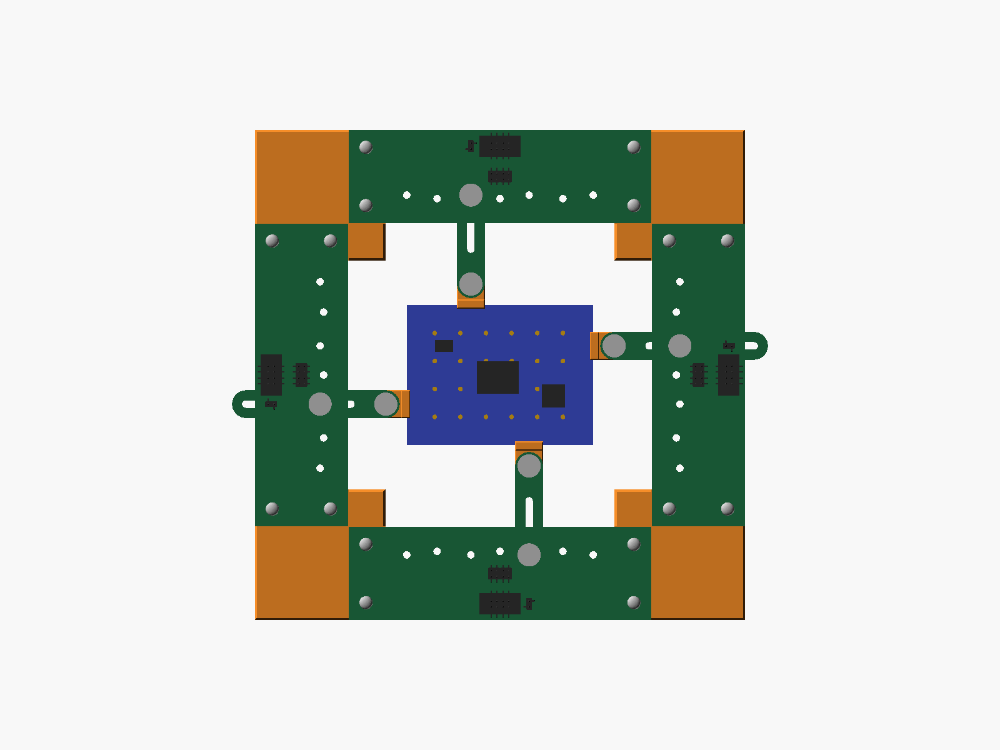
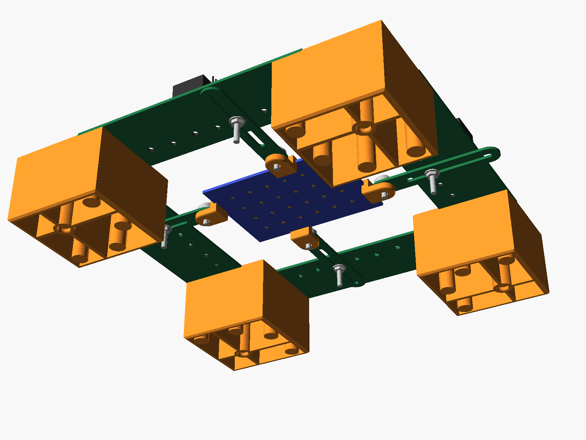
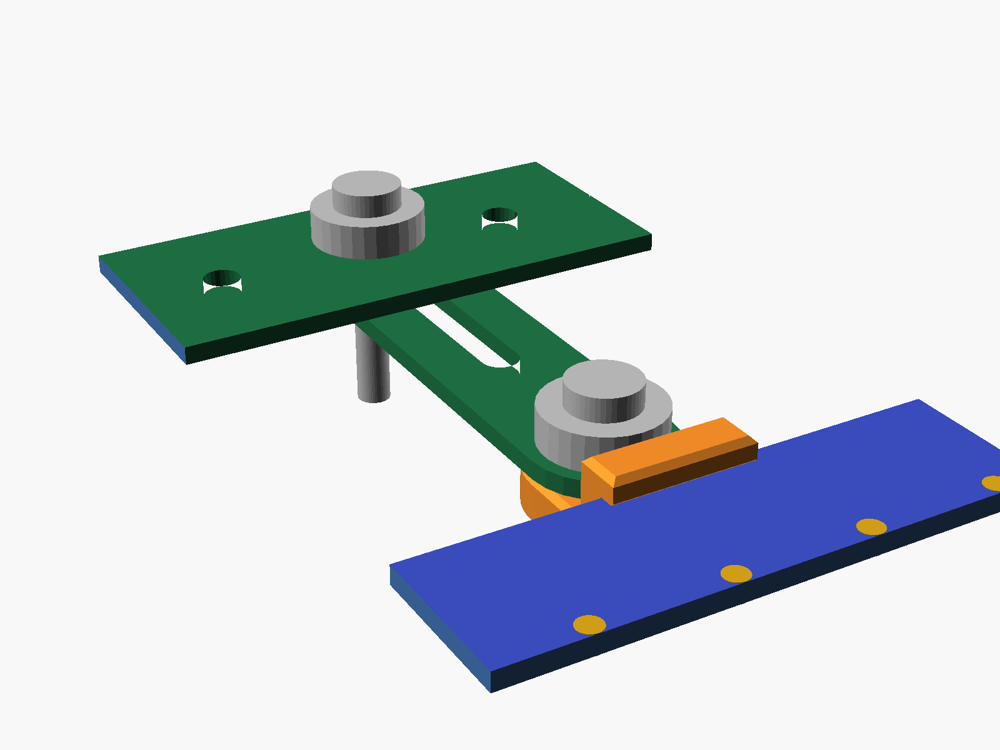

# PROBER X1

A hardware tool to help get access to PCB test points, on both sides of the PCB.



Four carrier PCBs are joined by 3D printed corners into a square frame. Mounting
arms are screwed under the carriers and hold the probes and the DUT mounts. The
DUT (device under test) is held at carrier height, so test points on both its
top and bottom side can be reached. Magnets in the corners keep the frame in
place on a steel base plate.

## USAGE

1. Place the frame on a steel plate, the corner magnets hold it in position.
2. Screw the mounting arms under the carriers. The slot in each arm lets you
   slide it in and out to the right position.
3. Slide the DUT edges into the slits of the DUT mounts at the arm tips and
   tighten the M3x8 thumb screws.
4. Position the probes on the test points and connect the carriers with the
   2x04 DuPont cables.

| Top | Bottom |
|-----|--------|
|  |  |

## BUILD

### Repository

| Path                  | Content                                          |
|-----------------------|--------------------------------------------------|
| `pcb/carrier/`        | Carrier PCB, KiCad project                       |
| `pcb/mounting_arm/`   | Mounting arm PCB, KiCad project                  |
| `3d/corner.scad`      | Corner connector, OpenSCAD source                |
| `3d/dut_mount.scad`   | DUT mount (PCB holder), OpenSCAD source          |
| `3d/assembly.scad`    | Complete assembly with an example DUT            |
| `3d/pcb/*.stl`        | PCB meshes exported from KiCad for the assembly  |
| `3d/render.sh`        | Exports the PCB meshes and renders `docs/img`    |
| `3d/*.stl`            | Print-ready exports of the OpenSCAD parts        |
| `3d/*.step`           | 3D models of the PCBs                            |
| `BOM.csv`             | Bill of materials                                |

### PCBs

Order 4x carrier and 4x mounting arm, 1.6 mm FR4. Assemble the SMD headers and
connectors on the carriers (see `BOM.csv`).

### 3D printed parts

| Part      | File                  | Quantity |
|-----------|-----------------------|----------|
| Corner    | `3d/corner.stl`       | 4        |
| DUT mount | `3d/dut_mount.stl`    | 4        |

- **Corner**: 56 x 56 x 40 mm square block. The carrier ends sit in pockets
  between the raised core (end stop) and the raised inner square (edge guide),
  with a 45° relief where the PCB corners meet. Hollow with an open bottom. Print upright, no
  supports needed; columns and ribs keep the ceiling spans short enough to
  bridge.
- **DUT mount**: the STL is already oriented standing on the slit face, so the
  slit prints vertical without supports.

Both parts are parametric. Open the `.scad` file in OpenSCAD and adjust the
values in the Customizer, or export from the command line:

```sh
openscad -o 3d/corner.stl 3d/corner.scad
openscad -o 3d/dut_mount.stl -D 'part="print"' 3d/dut_mount.scad
```

Set `part = "assembly"` to preview a part together with the PCBs.
`3d/assembly.scad` shows the complete prober. After changing a PCB or a part,
run `3d/render.sh` (needs `kicad-cli` and `openscad`) to update the PCB meshes
and the images in this README.

### Assembly

1. **Thread inserts**: press the M3 heat-set inserts into the four holes of
   each corner and the hole of each DUT mount with a soldering iron. Keep them
   straight and flush with the surface.
2. **Magnets**: glue a 6x2 mm neodymium magnet into the pocket on the bottom of
   each corner (CA glue or epoxy). Check the polarity is the same on all four.
   Do not melt them in: neodymium magnets lose strength above ~80 °C. To embed
   them instead, set `magnet_cover = 0.6` and insert them during a print pause.
3. **Frame**: lay the carrier ends into the corner pockets and fix each with
   two M3x8 button head screws.
4. **Mounting arms**: screw the arms under the carriers.
5. **DUT mounts**: place a DUT mount under the tip of each arm and fix it with
   an M3x8 thumb screw through the arm hole into the insert.



### Bill of materials

See [`BOM.csv`](BOM.csv).

## LICENSE

CERN Open Hardware Licence Version 2 - Strongly Reciprocal, see [LICENSE](LICENSE).
